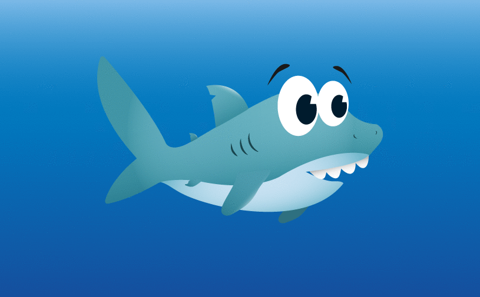
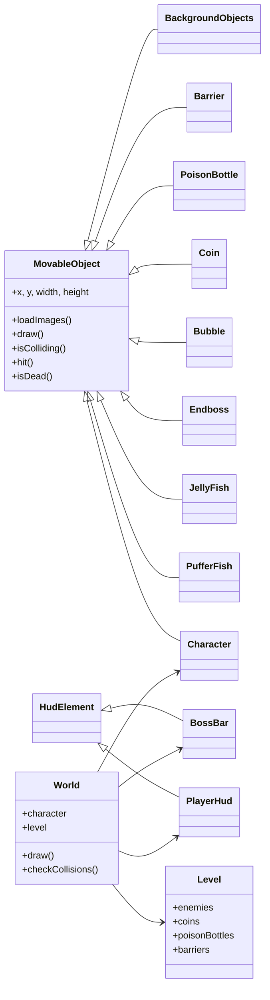

<div align="center">



# Sharkie

**Ein 2D-Unterwasser-Jump-'n'-Run im Browser, mit purem JavaScript und HTML5 Canvas gebaut.**

Schwimm durch die Tiefsee, sammle Münzen und Giftflaschen, weich Quallen und Kugelfischen aus und besiege den Killerwal am Ende des Levels.


[Features](#-features) •
[Steuerung](#-steuerung) •
[Spielmechanik](#-spielmechanik) •
[Schnellstart](#-schnellstart) •
[Architektur](#-architektur)

</div>

---

## ✨ Features

- 🦈 **Zwei Angriffe:** Flossenschlag für den Nahkampf, Blasen für Gegner auf Distanz
- ☠️ **Gift-System:** Gesammelte Giftflaschen machen Blasen zu Giftblasen, die beim Endboss Schaden über Zeit verursachen
- 🐡 **Drei Gegnertypen** mit eigenem Verhalten, eigenen Animationen und eigenen Schwächen
- 🐋 **Bossfight** mit Intro, Angriffen, Wutphase und Lebensbalken
- 📊 **HUD** mit animierten Balken für Leben und Gift sowie einem Münzzähler
- 📱 **Mobile Support** mit Touch-Steuerung, Safe-Area-Unterstützung (Notch) und Hinweis aufs Querformat
- 🔊 **Sound** mit Hintergrundmusik, Effekten und Stummschalt-Button
- ⛶ **Vollbildmodus** und Skalierung auf jede Bildschirmgröße
- 🧩 **Objektorientiert** aufgebaut, mit ES6-Klassen und JSDoc-Kommentaren
- 📦 **Keine Abhängigkeiten:** kein Framework, kein Build-Schritt

## 🎮 Steuerung

| Aktion | Tastatur | Touch |
| :--- | :---: | :---: |
| Schwimmen | <kbd>←</kbd> <kbd>↑</kbd> <kbd>→</kbd> <kbd>↓</kbd> | Steuerkreuz links |
| Flossenschlag | <kbd>Leertaste</kbd> | **Slap** |
| Blase schießen | <kbd>A</kbd> | **Blase** |

> [!TIP]
> Spar dir deine Giftflaschen für den Endboss auf. Jede Giftblase erhöht seine Gift-Stacks (bis zu 5), und je mehr Stacks er hat, desto schneller verliert er Leben.

## 🌊 Spielmechanik

<table>
  <tr>
    <th width="25%">Gegner</th>
    <th>Verhalten</th>
    <th>So besiegst du ihn</th>
  </tr>
  <tr>
    <td align="center"><br><b>Kugelfisch</b></td>
    <td>Schwimmt zwischen zwei Punkten hin und her und kommt in drei Farbvarianten vor. Bei Berührung wirst du vergiftet.</td>
    <td>Mit dem <b>Flossenschlag</b> oder einer <b>Giftblase</b>. Eine normale Blase bläst ihn nur auf.</td>
  </tr>
  <tr>
    <td align="center"><br><b>Qualle</b></td>
    <td>Bewegt sich zwischen zwei Punkten. Bei Berührung bekommst du einen Stromschlag, die Farbe bestimmt, wie viel Schaden er macht.</td>
    <td>Nur mit <b>Blasen</b>: Sie wird eingeschlossen und treibt nach oben.</td>
  </tr>
  <tr>
    <td align="center"><br><b>Endboss</b></td>
    <td>Taucht erst in der Boss-Arena auf, bewacht seinen Platz und greift dich mit Bissattacken an. Bei wenig Leben wird er wütend und greift öfter an.</td>
    <td>Flossenschlag (10 Schaden), Blase (5) und Giftblase (5 plus Gift über Zeit).</td>
  </tr>
</table>

<details>
<summary><b>Angriffe von Sharkie</b></summary>
<br>

| Flossenschlag | Blasen-Angriff |
| :---: | :---: |
|  |  |

</details>

## 🚀 Schnellstart

```bash
git clone https://github.com/RudolfSchultz/Sharkie.git
cd Sharkie
npx serve .
```

Öffne danach die angezeigte Adresse (z. B. `http://localhost:3000`) im Browser.

> [!IMPORTANT]
> Die Skripte werden über absolute Pfade (`/javascript/...`) geladen. Starte das Spiel deshalb über einen lokalen Webserver mit dem Projektordner als Root, zum Beispiel mit `npx serve`, `python -m http.server` oder der VS-Code-Erweiterung *Live Server*. Ein Doppelklick auf `index.html` reicht nicht.

## 🏗 Architektur

Alle Spielobjekte erben von `MovableObject`. Die Klasse `World` enthält den Game-Loop, zeichnet das Level auf das Canvas und prüft die Kollisionen.



<details>
<summary><b>Projektstruktur</b></summary>

```text
Sharkie/
├── index.html              # Einstieg: Canvas, Start-/Endscreen, Touch-Controls
├── style.css               # Layout, Screens, Responsive & Mobile
├── Impressum/              # Impressum-Seite
├── assets/
│   ├── audio/              # Musik & Soundeffekte
│   ├── font/               # Luckiest Guy
│   └── img/                # Sprites, Hintergründe, Buttons
└── javascript/
    ├── game.js             # Init, Screens, Tastatur, Mute, Vollbild
    ├── mobile.js           # Touch-Steuerung
    ├── levels/level1.js    # Leveldefinition
    └── models/
        ├── base/           # MovableObject, Keyboard, Geometry, Audio, Intervals
        ├── entities/       # Character, PufferFish, JellyFish, Endboss, Bubble
        ├── collectibles/   # Coin, PoisonBottle
        ├── hud/            # PlayerHud, BossBar, AnimatedBar
        └── world/          # World, Level, Barrier, Hintergrund
```

</details>

## 🙏 Credits

- Schriftart: [Luckiest Guy](https://fonts.google.com/specimen/Luckiest+Guy) von Astigmatic (SIL Open Font License, siehe `assets/font/Luckiest_Guy/LICENSE.txt`)
<!-- TODO: Herkunft der Grafiken und Sounds ergänzen -->

<div align="center">
<br>

Gemacht mit 💙 und viel Salzwasser von [RudolfSchultz](https://github.com/RudolfSchultz)

</div>
